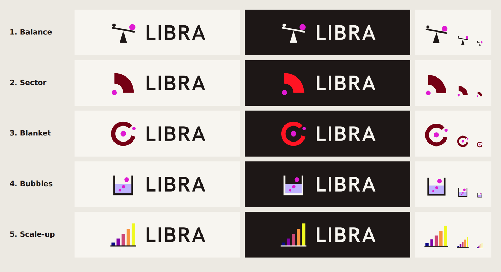

# Logo options

Five alternatives to the current logo (the LIBRA-project GitHub avatar, used
on the site since October 2026). They are proposals for the team to compare,
not in use anywhere. Each pairs a square mark with the LIBRA wordmark from
`../wordmark/` (outlined Hanken Grotesk 600, so no font is needed).

Each option has three SVGs:

- `*-mark.svg`: the mark alone, 100 × 100, for a favicon or avatar.
- `*-lockup.svg`: mark and wordmark, for light grounds.
- `*-lockup-dark.svg`: the same for dark grounds (ink becomes paper, MIT red
  becomes bright red).

Colours come from the PSFC palette in `../colours/`: ink, MIT red, Plasma
Pink for the one point of emphasis, Hydrogen Periwinkle for salt, and the
plasma colour map stops the site uses for experiment keys.

## The options

1. **Balance.** Libra is the balance. The beam tips towards a large pink
   dot against a small ink one: more tritium out than goes in, the
   TBR > 1 goal of LIBRA-One. The weakest at 16 px.
2. **Sector.** The LIBRA-Pi geometry: a quarter of an annulus of breeder
   wrapped around a point neutron source (the pink dot), seen from above.
   The simplest shape and the strongest at small sizes.
3. **Blanket.** A pink neutron source inside a ring of breeding blanket,
   with a tritium dot leaving through a gap in the ring. Reads well at
   every size; the closest to a classic symbol.
4. **Bubbles.** A vessel of molten salt with gas sparged through it,
   carrying tritium up and out: the BABY and LIBRA-Pint experiments. The
   most literal, and busy at 16 px.
5. **Scale-up.** Five bars rising in the plasma colours of the five
   experiments, from BABY 100 mL to LIBRA-One. Ties straight to the site's
   scale-up path, but could read as a generic bar chart or signal icon.

## Before adopting one

- PSFC communications should see it: LIBRA is a PSFC sub-brand, and a
  combined MIT or PSFC lockup can only come from them.
- Check it against the brand rules in `../README.md` (clear space,
  minimum size, no Plasma Pink text).
- Then replace `src/assets/brand/libra-logo.png`, `public/favicon.png` and
  `public/apple-touch-icon.png`, and update the GitHub organisation avatar
  so the two stay the same.
