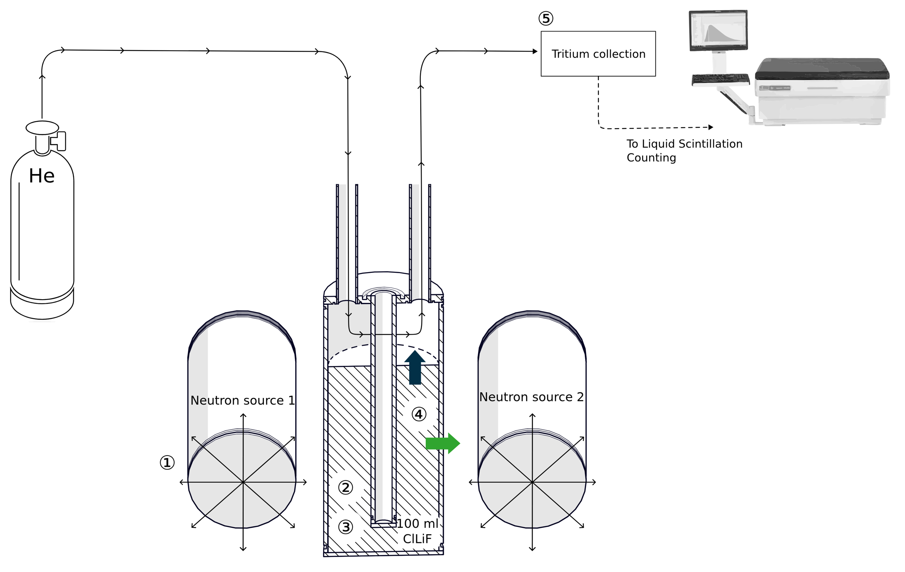

> **Draft guide.** Section headings show the proposed structure for every
> experiment guide. Text marked TODO needs input from the experiment team.

## Overview

BABY (Build A Better Yield) is the bench-scale stage of LIBRA. A small volume
of molten salt is irradiated by 14 MeV neutrons from deuterium-tritium (DT)
neutron generators. Tritium bred in the salt is carried out by a sweep gas,
captured in water bubblers, and counted by liquid scintillation. Comparing
the measured tritium against neutronics predictions validates the models used
to design breeding blankets for fusion power plants.

BABY is the dress rehearsal for the larger LIBRA experiments. Working at
small volumes lets the team build experience with molten salts, beryllium
safety, and tritium and neutron detection before scaling up. The 100 mL
experiments were the first BABY campaign. They used ClLiF, a LiCl-LiF salt
without beryllium, as a surrogate for FLiBe.

The next stage is [BABY 1 L](../baby-1l), followed by
[LIBRA-Pi](../libra-pi) (about 100 L) and [LIBRA-One](../libra-one) (700 L).

## Results

The 100 mL experiments made the first global measurement of the tritium
breeding ratio (TBR) in a molten salt: 3.57 × 10⁻⁴, from 1.17 × 10¹⁰
tritons bred for 3.35 × 10¹³ neutrons produced. The value is small because
only about 2% of the neutrons reach the salt at this scale. The model and
the measurement differ by about 25%, which the team attributes mainly to
tritium permeating through the crucible walls. The results are published in
[Nuclear Fusion 65, 026037 (2025)](https://doi.org/10.1088/1741-4326/ada2ab).

## Experimental setup

*How BABY works: (1) DT generators produce 14 MeV neutrons; (2) neutrons
breed tritium from lithium in the salt; (3) the tritium moves through the
salt; (4) it is released into the helium sweep gas or permeates the walls;
(5) it is collected and counted by liquid scintillation. Figure from
Delaporte-Mathurin et al., [Nucl. Fusion 65 026037 (2025)](https://doi.org/10.1088/1741-4326/ada2ab),
CC BY 4.0.*

Photos of the set-up are in the "In the lab" section below.

### Breeder and containment

The 100 mL of salt sits in an Inconel 625 crucible inside a secondary
container and is heated to 700 °C.

TODO: salt preparation and temperature control.

### Neutron source

Two commercial sealed-tube DT neutron generators, one on each side of the
crucible, provide 14 MeV neutrons at about 5 × 10⁸ neutrons per second in
total.

TODO: irradiation length per run, source position and shielding.

### Gas handling and tritium collection

Dry, oxygen-free helium flows over the salt. The gas then passes two sets
of 2 × 2 water bubbler vials separated by a catalytic oxidation furnace: the
first set captures water-soluble tritium (HTO), and the furnace converts
insoluble forms (HT, T₂) so the second set captures those too. The gas keeps
bubbling during and after irradiation, and vials are sampled periodically.
The minimum detectable activity is about 0.07 Bq per vial.

## Diagnostics

- **Activation foils** measured by HPGe and NaI spectroscopy give the neutron
  fluence on the crucible.
- **Proton recoil telescope (PRT)** and **diamond detectors** monitor the
  neutron source in real time. TODO: confirm which were used in the 100 mL
  runs.
- **Liquid scintillation counting (LSC)** of bubbler samples gives tritium
  release over time.

## Running an experiment

The outline of a BABY run, as presented by the team at SOFE 2025:

1. Add the breeder to the crucible and place it in its secondary container.
2. Heat to 700 °C.
3. Flow dry, oxygen-free gas over the salt.
4. Irradiate with 14 MeV neutrons.
5. Let the gas bubble through the water bubblers during and after
   irradiation, sampling occasionally.
6. Count the samples by liquid scintillation.

TODO: the detailed checklist used for the 100 mL runs.

## Data and analysis

Data for runs 3 to 8 is in
[BABY-100-mL-runs](https://github.com/LIBRA-project/BABY-100-mL-runs),
archived on Zenodo. The analysis behind the Nuclear Fusion paper is in
[insights-from-BABY-experiment-paper](https://github.com/LIBRA-project/insights-from-BABY-experiment-paper).

Analysis uses [libra-toolbox](https://libra-toolbox.readthedocs.io/en/latest/),
the shared Python package for neutron detection and tritium analysis.
