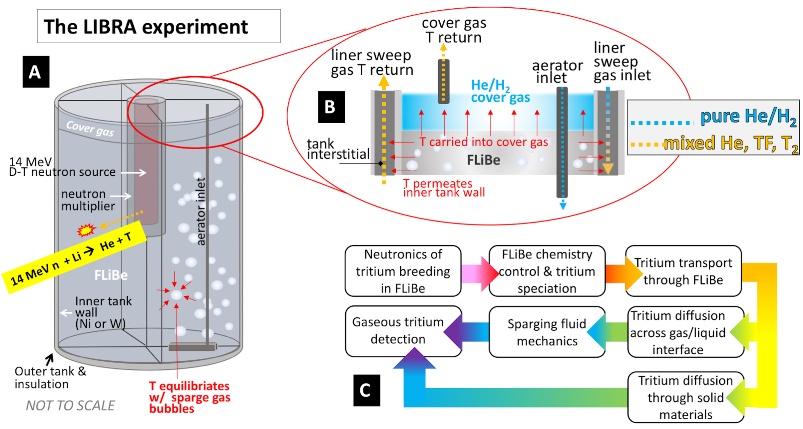

> **Draft guide.** Sources: the
> [LIBRA-one](https://github.com/LIBRA-project/LIBRA-one) model repository and
> Ferry et al.,
> [Fusion Sci. Technol. 79, 13-35 (2023)](https://doi.org/10.1080/15361055.2022.2078136).
> Sections marked TODO need input from the experiment team.

## Overview

<mark>"The moniker? LIBRA One → TBR > 1."</mark> The long-term goal of LIBRA is
a tritium breeding ratio of at least one: an experiment that breeds more
tritium than its neutron source consumes, which any self-sustaining fusion
power plant will need. <mark>The team describes a global TBR of 1 as a world
first for a fusion blanket experiment.</mark>

LIBRA-One builds on the [BABY 100 mL](/experiments/baby-100ml),
[BABY 1 L](/experiments/baby-1l) and [LIBRA-Pi](/experiments/libra-pi)
experiments. It replaces the earlier plan for a LIBRA of about 0.5 m³
(1000 kg) of FLiBe in four independent quadrant tanks.

## Design

The current model in the [LIBRA-one repository](https://github.com/LIBRA-project/LIBRA-one):

- A single annulus of FLiBe, with no quadrants: 40 cm thick and 80 cm tall,
  from an inner radius of 12.1 cm, about 645 L before the heater tubes.
- A beryllium neutron multiplier, 5 cm (2 in) thick, and a 10 cm graphite
  reflector.
- A TBR of 1.07 from the OpenMC model.

<mark>The design aims for a TBR of about 1.05, so that the goal of TBR > 1 is
met with margin, with a 14.1 MeV DT neutron generator at the centre of 700 °C
salt, protected by a vacuum insulation sleeve conceived from the thermal shield
of the Alcator C-Mod advanced outer divertor.</mark>

*The original four-quadrant LIBRA design that LIBRA-One replaces: (A) a DT
neutron generator surrounded by a cylindrical tank of FLiBe about 1 m across,
divided into four independent quadrants, each with its own sparging and sweep
gas system, with an interstitial between the tank liner and the outer tank
through which a sweep gas can pass; (B) tritium carried to detection by the
cover gas or the liner sweep gas; (C) the coupled physics. From Ferry et al.,
Fusion Sci. Technol. 79, 13-35 (2023), Fig. 3. Which of these gas streams
LIBRA-One keeps is TBC.*

<mark>Status: in final design (2025).</mark>

<mark>TODO: facility, shielding and schedule, once confirmed by the team.</mark>

## Modelling

The [LIBRA-one repository](https://github.com/LIBRA-project/LIBRA-one) holds
the OpenMC neutronics model (`run_model.py`) and the FESTIM tritium
transport model (`festim_model.py`) of the experiment.

<mark>TODO: summarise the models and main results.</mark>

## Data and analysis

<mark>TODO</mark>
